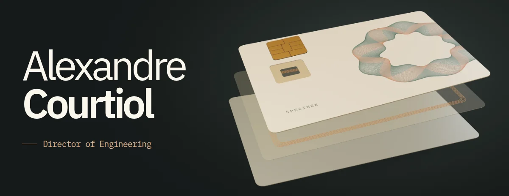

<h1>
  <a href="https://alexandrecourtiol.com/">
    <picture>
      <source media="(prefers-reduced-motion: no-preference)" srcset="assets/payment-card-opening.webp">
      
    </picture>
  </a>
</h1>

I’m Director of Engineering at **Groupe Chantelle**. My team builds and runs the online stores for five brands across ten countries. The payment card in the cover is a nod to my apprenticeship at Sopra Banking Software, where I worked on card issuing, acquiring and clearing.

[Portfolio](https://alexandrecourtiol.com/) · [Site en français](https://alexandrecourtiol.com/fr/) · [LinkedIn](https://www.linkedin.com/in/alexandre-courtiol/)

## Selected work

**One storefront across markets.** At Chantelle we went from six commerce platforms to two. The European stores on Magento and the US store on BigCommerce share a Next.js storefront. We can now change a product page once for several markets. Overall e-commerce revenue grew by double digits each year from 2021 to 2025. [Inside the migration](https://alexandrecourtiol.com/blog/six-platforms-to-two/)

**A figure you can trace.** I set up the Berlin Digital Factory for Société Générale Equipment Finance. We built a tool that let credit analysts click a figure and see where it came from on the original balance sheet. Average document review fell from about two weeks to a day or two. Analysts made the credit decision. [How the document check worked](https://alexandrecourtiol.com/blog/ai-before-it-was-cool/#the-analysts-balance-sheet)

**MageLift.** I built a command-line tool to deploy Magento into your own AWS or Google Cloud account. At Société Générale and SGEF, I also helped open GitHub organisations so our teams could publish their code. [MageLift on GitHub](https://github.com/magelift/magelift)

## Writing and independent work

I wrote up the GPU bill for Chantelle’s internal AI assistant and the time we spent keeping its source documents useful. [What production RAG cost us](https://alexandrecourtiol.com/blog/what-production-rag-cost/)

I’m based in France and take on remote technical audits, architecture reviews, coaching and hands-on projects in the evenings and at weekends. [Discuss a project](https://alexandrecourtiol.com/contact/)
